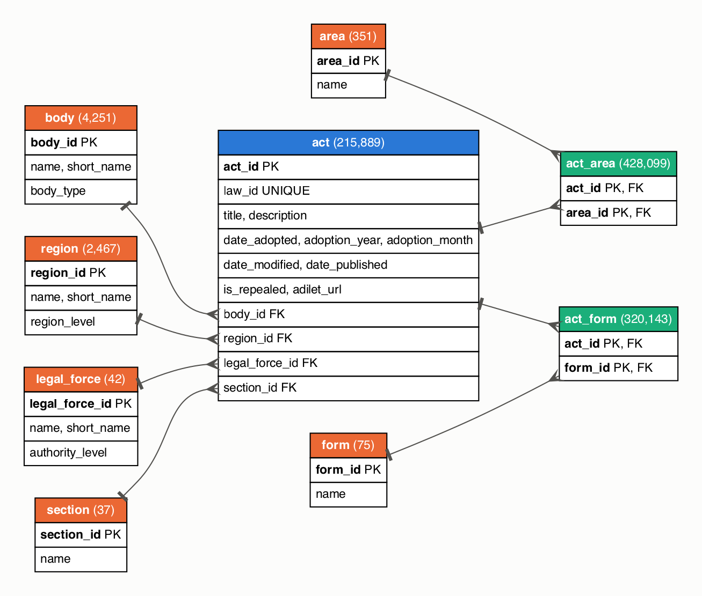

# Kazakhstan Legislation Analytics

Final project, *Programming for Data Analysis and Database* - topic **14**, team AAI-2603.

Analyses the dynamics of 215,889 Kazakh legal acts (1947-2026) by year, act form, adopting
body, region and repeal status: chunked loading into Parquet with dtype optimisation, a
metadata quality audit, a normalised SQLite schema with 12 analytical queries (CTE, window
functions), time-series analysis with a forecast-vs-baseline comparison, and a Streamlit dashboard.

| Member              | Main responsibility                                                                       |
|---------------------|-------------------------------------------------------------------------------------------|
| Kaisar Baltabayev   | Data loading (chunked CSV → Parquet, dtypes), benchmarks, console app & project structure |
| Adilet Bekbulat     | Metadata audit, normalisation, SQLite schema, ER diagram, SQL queries                     |
| Yelarys Nurbakytuly | Time series, forecasting, visualisations, Streamlit dashboard                             |

## Data

**KazakhLawCorpus-clean** (CC BY 4.0) -
<https://huggingface.co/datasets/Arailym-tleubayeva/KazakhLawCorpus-clean>
One CSV, 336 MB, 215,889 rows × 25 fields. It is too large for the repository, so it is
downloaded automatically by the pipeline into `data/raw/`.

## Run

Requires Python 3.10+ (tested on 3.12, macOS).

```bash
python -m venv .venv
source .venv/bin/activate          # Windows: .venv\Scripts\activate
pip install -r requirements.txt

python main.py --all               # full pipeline (~1-2 min after the download)
python main.py                     # interactive console menu
streamlit run dashboard.py         # dashboard at http://localhost:8501
pytest -q                          # unit tests
```

`python main.py --all` downloads the CSV, builds `data/processed/acts.parquet` and
`data/processed/legislation.db`, and writes all figures to `reports/figures/` and all
tables (audit, SQL results, benchmarks, forecast metrics) to `reports/tables/`.

Console menu:

```
1 - Run full pipeline        5 - Time series & forecast comparison
2 - Load data (CSV→Parquet)  6 - Benchmarks (CSV vs Parquet, Pandas vs SQL)
3 - Metadata quality audit   7 - Run one analytical SQL query
4 - Build SQLite + queries   8 - Search acts by keyword in the title
0 - Exit
```

## Structure

```
main.py            console menu (entry point)
dashboard.py       Streamlit dashboard with filters (year, authority, territory, region, form, status)
src/config.py      paths and column-name constants
src/ingest.py      download, chunked CSV reading, dtype optimisation, Parquet
src/audit.py       missing values, placeholders, date validity, multi-value fields, consistency
src/normalize.py   multi-value splitting, dimension classification, relational tables
src/database.py    SQLite schema loading and query execution into Pandas
src/queries.py     12 named analytical SQL queries
src/timeseries.py  resampling, rolling means, decomposition, IQR outliers, forecasts
src/benchmark.py   CSV vs Parquet and Pandas vs SQL (time + memory)
src/plots.py       matplotlib / Plotly figures
src/pipeline.py    orchestrates all steps
sql/schema.sql     DDL with indexes
docs/er_diagram.*  ER diagram (Graphviz source + PNG)
tests/             pytest unit tests
reports/           generated figures and tables
```

## Database schema



`act` is the fact table; `body`, `region`, `legal_force` and `section` are dimensions
(with derived `body_type`, `region_level`, `authority_level`); `act_area` and `act_form`
resolve the many-to-many fields `legal_relation_area` and `act_form`.

## Key results

| Comparison                                                 | Result                    |
|------------------------------------------------------------|---------------------------|
| CSV (object dtype) vs Parquet, load time                   | ~1.2 s → ~0.15 s          |
| Peak memory: CSV object dtype vs Parquet (4 columns)       | ~900 MB → ~200 MB         |
| On-disk size: CSV vs Parquet                               | 321 MB → 35 MB            |
| Forecast MAE (2023-2025 hold-out): naive baseline          | 1,738.7                   |
| Forecast MAE: seasonal naive / linear regression / 12-m MA | **207.3** / 224.4 / 374.2 |

Exact numbers vary by machine; they are regenerated in `reports/tables/` on every run.
